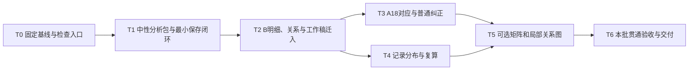

# B关注内容、联系与分布：正式施工计划

日期：2026-11-13。状态：**#6积压与T0基线整理进行中；T1—T6新业务功能待实施**。业务目标和边界以[唯一业务规格](../specs/b-attention-distribution.md)为准；本计划安排实现，不另立业务标准。已核对的成果、源码位置、工作区版本和实际验证见[基线记录](b-attention-distribution-baseline.md)。后续进展归[STATE](../STATE.md)。

## 交付范围与先后结果

最终贯通：**选择已有材料和A版本 → 理解B观点、方面及表达功能 → 整理主题与有范围的关系 → 对照A18 → 查看本批分布 → 明细、可选图形、原文回查 → 纠正、应用保存、重开。**

本次直接使用已收拢的两份外部意见、14记录工作稿、六个A样例及既有规则；不再安排AI征询。13主题、93方面和8处关系是迁入起点，可随材料纠正，不设为必须复现的最终数量。中文相关研究覆盖沿用用户决定，留在当前A清单外。论文与原分只按需帮助理解表达和语境，分析确认表示处理忠实。

施工分三次形成可演示结果：

1. **M1：先打通无framework的保存闭环。** 打开本地材料、显示原话原分、编辑一项B分析、应用补丁并重开；不需要先生成条款问题或批准任何标准。
2. **M2：完成可复算的本批分析。** 14记录的B明细、A18逐项查看、多重/部分及清单外内容、分母和记录集合能相互回查；没有图形也能理解。
3. **M3：接可选视图并完成往返验收。** 矩阵、局部关系图与明细共用已保存结果；完成纠正、重开、过期检测与最终审查。

## 收拢结果与实施取舍

- **直接复用**：冻结原件/原分、Unicode证据校验、源工作区只读读取、补丁事务/冲突/幂等、历史、恢复和来源定位的既有实现与经验。
- **适配后复用**：普通编辑控件、来源选择、桌面后台操作、旧batch的快照/失效检测。复用机械能力，保留旧产品接口与历史数据的原语义。
- **新增**：无framework的关注分析包、跨记录主题及稳定方面、表达功能与套话候选分开保存、带作用域关系、A18内容对应、记录并集统计及可选图形。
- **不作为前置**：新增模型调用、重新解析全部论文、补齐教师/轮次/精确送审版、专业裁决B、评分建模、修订A、迁移标注平台或固定数学本体。已有材料足以启动本批施工。

## 工程落点与数据约定

### 独立分析包，沿用本地工具链

新增关注分析Module，拟落在`reviewproto/attention.py`；提供构建、读取、应用补丁和恢复的窄Interface。中性输入冻结材料、A参照和初始分析，不接受旧framework/issue作为必填。拟新增`attention-build / attention-apply / attention-recover`与对应桌面操作；这些是待实施名称，当前CLI尚不存在。

沿用Python标准库SQLite/JSON、静态HTML/原生JS、Tk及已有文档解析依赖。分析包使用独立数据库标识与版本，拟名`attention.sqlite3`；原始源工作区只读。旧`review.sqlite3`、旧batch及其补丁不自动迁移或写穿。共用证据与保存校验的必要小函数，避免另建一套来源解析器，也不为统一名称重构全部旧代码。

使用两种明确区分的来源Adapter：已有Workspace的普通分区快照，以及已经整理的本地可见文字转录。后者绑定转录文件字节、记录锚点、原文hash及原件映射；不伪称是旧解析器产物。可从已有转录开始，不以14份原表重新通过旧解析器为门槛。论文只保留本地定位引用及必要语境，不建立通用论文检索库。

### 最小持久化内容

具体JSON字段在T1落成契约与合成夹具；必须表达下列已经发生的材料关系：

- **记录与证据**：稳定record_id、R别名、来源种类/指纹/分区或锚点、原话、原分字符串、可核实的材料分组。证据绑定来源和Unicode范围；同文重句按位置区分。
- **观点与方面**：独立opinion_id及facet_id、父子/替换沿革、证据、对象、方向、程度、否定、理由、动作与条件。旧candidate可作有版本的输入引用；新分析有自己的当前视图，不与源候选双向同步写入。
- **主题与表达作用**：跨记录主题定义/边界/版本，成员绑定到方面并带依据；可多归属。套话候选特征与本次肯定、转述、建议等作用分别存，允许同段兼具；保留工作读法及其他有据读法。
- **关系**：稳定关系ID、类型、端点及角色、方向、作用范围、证据、明示/推断/未知及复核状态。多动作可组成关系组；未知方向或指代如实保留，不用成员列表冒充已知因果或排他分支。
- **A参照及对应**：冻结版本、5部分18项完整原话/限定与定位。每个方面可有0至多个A关联，逐关联说明范围、理由及对应/部分/相关/暂未定；清单外另有具体内容范围，可与已有对应共存。它们不转成强制条款或评分权重。
- **修订**：分析规则/主题/A版本、输入绑定、base_revision、修改者声明、理由、时间、补丁指纹及历史。工作解释、待核、已核对和撤回分开，不自动继承机器确认或认可B结论。

初始Rxx-Fnn只作旧别名；导入映射持久保存，重排/改名不改身份。拆分/合并生成新身份并保留替换沿革；受影响主题、关系及A对应显式待核，不按首项、位置或相似度自动转绑。

### 保存、上游变化和显示一致性

当前分析的修改统一进入分析包补丁；校验成功后一次事务保存，按同一修订重建明细、统计和图形。页面标明修订、输入/A/规则版本。下载仅是草稿导出；本机应用成功才显示已保存。提交成功但输出失败时，保留已提交状态并引导恢复，禁止重复造修订。

静态页面的未应用草稿与已保存视图区分显示；有草稿时，统计/图形标明仍属于已保存修订。应用并重开后各视图必须一致，不要求已打开的其他标签页实时更新。备份/恢复按整份可信分析包操作，不能只复制HTML当恢复。

源Workspace后续被纠正、原文/A版本被替换或输入选择变化时保留旧快照并标`needs_revalidation`；刷新采用明确的新输入和身份核对，旧关联不得静默继续称当前。修改来源转录另存新来源版本，不修改冻结原文。普通页面及导出继承本地可信编辑权限；隐藏字段不提供身份隔离。

### 分布的唯一计算口径

由一个纯计算Module（拟`reviewproto/attention_summary.py`）从同一当前分析及显式筛选生成记录集合、数值和图例；明细汇总、矩阵和关系视图消费该结果，不各写一份统计。

主要单位是不同评语记录。相同原件/绑定副本及同记录重跑不增加record；不同文件疑似同一记录仅在有依据的显式别名映射后合并，不能凭文件名或语义相似处理。当前14条是记录，不是14位教师。材料分组只使用已给且可核对的关系。

分母是显式选择的记录集合N；记录/材料筛选改变N，方向、套话或解释状态筛选只改变被计表达，默认不把未命中记录移出N。显示本批总N、当前N、口径及命中record_id。默认呈现工作分析并分列核对状态，不以旧effective视图仅含confirmed的限制隐藏已有待核解释。

主题和A子项分别按record取集合，父主题及A五部分按子项集合并集；重叠合计可以超过N。明确对应、部分、相关与暂未定分别显示，不能合称明确覆盖。流程/条件关系另列；原分保留记录层，不拆句子分数。频次不作权重或群体共识，未提及不作不关注结论。

## 实施顺序与依赖

T3与T4仅在T2的对象/对应形状及Interface已集成验收后可并行：T4用合成对应记录验证计算，不依赖T3已完成的真实标注；T3拥有A编辑控件，T4拥有纯计算模块。真实A分布及M2需两票集成才验收。其余按图串行，前置“已派出”或“代码已写”不释放依赖。

### T0 固定当前成果和验证入口

- **依赖**：无；从[基线记录](b-attention-distribution-baseline.md)重查实际工作区，不能只从旧HEAD开工。
- **范围/所有权**：实施代理负责基线清单、必要的测试入口及合成测试接线；统筹管理隔离与材料权限。先保存当前跟踪/未跟踪代码的可复验快照，在隔离集成基线核对指纹；不清理或整体提交现有工作区。
- **交付**：固定源码基线、既有全套测试实跑及跳过原因；一条仓库检查入口。选仓库内Windows CI配置运行现有unittest及新增合成不变量，不安装全局hook；配置准备不冒称远端已经运行。
- **验收**：隔离基线包含现有未提交实现；正常合成输入通过，故意破坏一条引文断言时检查失败；私有材料、密钥及工作包不进入测试或CI。
- **验证**：`python -m unittest discover -s tests -v`，记录环境、数量/跳过/失败与版本。浏览器任务另列必需环境，缺失时不能签收界面验收。

### T1 无framework的分析包与第一条保存路径

- **依赖**：T0验收。
- **范围/所有权**：`attention.py`及来源Adapter、初始契约/合成夹具；串行接入`cli.py`、`desktop.py`与最小`attention_render.py`。旧batch接口保持原产品身份。
- **交付**：选择/冻结普通材料和A参照、来源清单、最小B分析项、补丁事务/历史、recover；桌面可打开新包、应用分析补丁并重开。不要求framework或旧issues。
- **验收**：一份合成转录和一份已有合成Workspace均能走完“打开→原话原分→修改一项解释→应用→重开”；无A评分权重、条款决定或模型请求步骤。源库不被写回，未知来源/私密分区和错误证据原子拒收。
- **验证**：V01、V02、V03、V08、V09；核心行为改动后运行全套unittest。至此交付M1的最小路径，不把空schema当成果。

### T2 B明细、表达功能、主题关系与工作稿迁入

- **依赖**：T1验收。
- **范围/所有权**：B分析对象与补丁扩展、`attention_render.py`、独立`attention_editor.js`、显式工作稿Adapter；本地迁入记录写`work/`，测试只用合成材料。
- **交付**：可补录/拆分/归并观点、保留方面与条件、编辑主题及成员依据、记录套话候选与表达作用、编辑带角色关系。迁入14记录原话原分及已有工作解释，保留旧别名映射和原样稿。
- **验收**：不丢总体肯定、否定/程度、例示、单条件备用动作及相反判断；主题重命名/重排不改身份；拆合后关联显式待核。93方面均有迁入或有理由的调整去向，但最终数量可不同。旧8关系的角色/范围逐条核对，歧义不补造。
- **验证**：V02、V03、V04、V08；复用20个合成反例及已有六案例。单独检查重复引文，不用raw.find首匹配冒充定位正确；全套unittest及普通表单往返。

### T3 A18逐方面对应与纠正

- **依赖**：T2验收及其中的对应形状固定。
- **范围/所有权**：A参照导入/校验、对应补丁及A普通控件；与T4计算模块分工，公共文件改动串行交接。
- **交付**：A18完整原话/限定/版本可查，方面可添加多个对应并编辑范围和理由；部分、相关、清单外及暂未定可共存。沿六个样例完成本批各方面的处理去向，并逐项检查A18。
- **验收**：中文相关研究覆盖保留在外；同句不同方面可分别对应/在外；通用认可不点亮全部A；未见对应的A条目如实显示。没有强制归类、强制达标或A修订动作。
- **验证**：V05、V08；六个真实样例仅在本地核对，公开回归采用相同结构的合成材料。每条对应复核证据支持范围与理由；不能以引文存在代替语义支持。

### T4 分布、筛选与可复算明细

- **依赖**：T2验收；依据固定Interface，用合成A关联开发，与T3可并行。
- **范围/所有权**：`attention_summary.py`及其测试、汇总显示数据；不并行改A编辑文件。
- **交付**：主题/A条目/五部分的记录集合和分母，方向与解释状态分列、明确筛选口径、原分语境和可回到记录的汇总。辅助观点数/方面数单列。
- **验收**：副本、重跑、多方面/多映射不会抬高独立记录；A父部分取并集；部分/相关/待核不合称明确覆盖；每个数能列出record集合并复算。T3集成后用14记录实际明细验收M2。
- **验证**：V06、V07、V08；用有手工可算集合的合成反例测试，包含重复副本、重跑、跨A部分、混合状态、过滤后零命中和分母变化；不只比对实现自己的输出。

### T5 可选择的矩阵与局部关系图

- **依赖**：T3、T4均集成验收。
- **范围/所有权**：关注渲染/交互视图；复用汇总结果与普通来源定位。优先HTML矩阵和原生SVG局部关系图，不新增图数据库、聚类平台或图形运行依赖。
- **交付**：记录×主题/A条目的矩阵，以及可选择的观点/方面/关系组局部图；两者均可关闭，明细仍完整可用。点、线、颜色、计数、方向和未知范围有说明，点击回到对应证据。
- **验收**：一个复合观点能跨主题/A部分并含在外内容；条件只连接所约束动作；相近主题、理由关系和流程不用同一种线冒充同义或因果。不用空间距离推测未测相似性，不推造教师节点身份。
- **验证**：V08、V10、V11；浏览器真实操作、宽/窄窗口及键盘路径；与关闭图形的明细核对同一revision、筛选、分母和record集合。

### T6 本批贯通、独立审查与交付

- **依赖**：T5验收；T0—T5的集成与证据齐全。
- **范围/所有权**：统筹汇总；独立merger串行集成；Spec和Standards只读审查；一名实施者集中返修。真实结果只在本地可信工作区生成。
- **交付**：4论文/14记录/56原分的可打开分析包，A18逐项查看与全部方面去向、说明过的未知、必要局部关系和可选图形；操作/备份恢复说明及固定版本验证记录。保留旧样稿与原材料。
- **验收**：完成下面V01—V12和规格五项验收；至少实际纠正切分、主题、条件范围及A对应各一次，应用保存/重开后核对明细、集合计数与图形；恢复失败、冲突和上游变化有可复现路径。未完成语义核对的工作解释明确标记，不等待专业裁决B。
- **验证**：固定比较基线及集成版本，独立Spec/Standards审查、集中返修后重验；全套unittest、必需浏览器场景、受控真实数据核对和恢复演练。用户本人体验另记，不把代理验收写成用户已试用。

## 验收与验证清单

以下是新业务功能施工检查项；#6底座回归不代替这些验收。

- **V01 直接进入**：完全不提供framework/旧issue，也能选择材料、A参照并建立关注分析；命令及桌面两入口一致。
- **V02 来源忠实**：原文/原分字符串与冻结输入一致，重复句和非BMP字符定位正确，错误来源/区间拒收；论文只用于必要指代语境。
- **V03 身份和沿革**：同记录重跑不增记录，主题/方面重排不换ID；拆合保留父子/替换历史，相关关联待核而非自动转绑。
- **V04 B解释保真**：检查已知漏项、误合、指代错置、条件/否定/程度/例示丢失；套话特征和实际作用独立；接受保留全部信息的替代组织。
- **V05 A对应**：A18逐字、限定和版本完整；六类既有样例及全批方面去向可核对；部分、相关、在外与待定不被强制吸收。
- **V06 计数不变量**：独立记录集合/分母可手算；副本、重跑、多方面、多A映射、父部分并集及流程分列均有会失败的反例。
- **V07 筛选含义**：记录筛选改变N，表达筛选不默认缩小N；每个图表注明口径、状态、规则版本和命中集合，零命中仍保留明确分母。
- **V08 保存往返**：下载未应用不显示已保存；应用幂等、旧修订冲突、坏补丁原子拒收；草稿和已保存视图有标识；恢复/重开三种视图同revision。包括提交后输出失败及整包备份恢复。
- **V09 上游失效与权限**：源/A/选择变化后旧结果保留并待核；只读来源不改写；私密区不进入分析包普通导入或公开测试，HTML/导出不冒称作者端。
- **V10 可选图形**：关闭图形仍完成全部理解与回查；矩阵重叠可解释，图中每条边可查角色、范围及证据。
- **V11 普通操作可用**：选择、补录/拆合、主题/关系/A对应、下载与应用、重开均有普通控件；浏览器条件缺失时单列未执行，不能用跳过签收。
- **V12 真实批次与边界**：14记录/56原分和A18全量保留，4论文仅作本地语境；逐记录检查处理遗漏/误合及关键限定，不要求B专业结论正确。最终计数若随纠正变化，给出修订差异和集合，保留旧样稿。

规格验收追踪：第1项由T1/T3及V02/V05落实；第2项由T2及V03/V04落实；第3项由T3/T4及V05—V07落实；第4项由T2/T5及V10/V11落实；第5项由T1—T5共同使用保存Interface，以V08/V09验证。T6逐项汇总，不以截图或测试数量代替这些行为证据。

确定性检查负责指纹、区间、ID/引用、集合、冲突、幂等和往返；解释核对负责引文是否支持观点、关系作用域、主题误合及A对应理由。两类证据分别记录。工程测试用合成输入；真实逐字材料及语义复核记录留在受控`work/`。

## 派工、集成与开始条件

按[项目工作流](../agents/workflow.md)执行，主代理唯一对接。后续多票代码实施使用独立worktree与分支；由专属merger逐票串行集成，前置成果已集成且验收通过才释放依赖。T3/T4具备并行条件时仍分别指定文件所有权，公共文件变更串行交接。

按用户最新顺序，先将47个历史提交及69项工作区积压分批核对、验证、双轴审查并合入main，再回到本职T1—T6。当前#6/T0整理正在进行，不能把未合main的隔离快照写成已交付，也不能把从旧HEAD新开的worktree误当完整底座。正式派工时给出固定规格/基线、输入权限、所有权、验收、必要验证和预期证据；实现文件名可在不改变Interface与业务行为的前提下由实施者调整并记录。

本批不存在必须再向用户征询的业务阻塞。实现中先用既有原话和样例解决；只有新的A含义歧义实质改变对应且现有材料无法判断，才由统筹集中提供具体实例，其他任务继续推进。

本计划沿用原T0—T6行为、依赖、验收与验证，不另立路线。#6基线整理结束后继续推进本职；T0检查入口为 `scripts/check.ps1`，环境与执行方式见[测试说明](../TESTING.md)。当前业务尚未进入T1—T6，进展归STATE和对应Issue/PR；新费用、材料外发、标准发布仍按各自授权边界处理。
